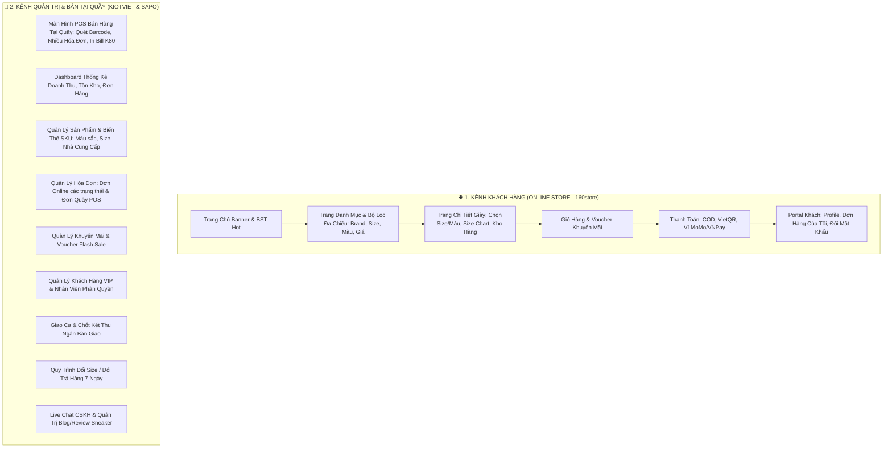
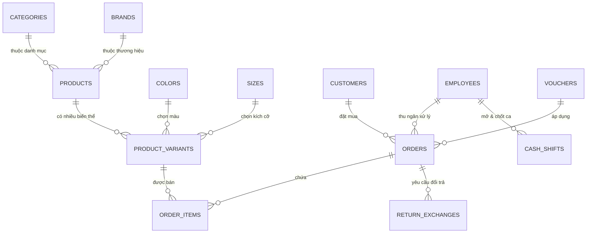

# HỆ THỐNG BÁN GIÀY ĐA KÊNH VIBEFLOW (OMNICHANNEL SNEAKER PLATFORM)

> **Nhận diện thương hiệu:**
> - **Logo VibeFlow:** Tone Đen mờ (Matte Black), Chữ Trắng và Điểm nhấn Xanh Dạ Quang Neon Lime (`#c6f500`).
> - **Kênh Khách Hàng (Online Storefront - [online.html](file:///C:/Users/FPT/.gemini/antigravity/scratch/shoe-store/online.html)):** Phong cách thời trang đường phố trẻ trung, hiện đại như **160store**, Sneaker Daily.
> - **Kênh Quản Trị & POS Tại Quầy (Internal Admin & POS - [admin.html](file:///C:/Users/FPT/.gemini/antigravity/scratch/shoe-store/admin.html)):** Tối ưu bán lẻ tốc độ cao, phím tắt F2/F3/F9, chia song song 2 hóa đơn, quản lý biến thể đa thuộc tính như **KiotViet** và **Sapo**.
> - **Cổng Đăng Nhập Phân Quyền ([login.html](file:///C:/Users/FPT/.gemini/antigravity/scratch/shoe-store/login.html)):** Đăng nhập tự động phân luồng (Khách hàng vào online.html, Admin/Thu ngân vào admin.html).
> - **Cổng Điều Hướng Trung Tâm ([index.html](file:///C:/Users/FPT/.gemini/antigravity/scratch/shoe-store/index.html)):** Hub kiểm tra phiên đăng nhập và định tuyến người dùng.

---

## 1. Bản Đồ Phân Hệ Chức Năng (System Sitemaps)



---

## 2. Thiết Kế Cơ Sở Dữ Liệu Chi Tiết (Database Schema ERD)

Ngành bán lẻ giày dép có tính chất phức tạp về **biến thể thuộc tính** (Size 38-45 kết hợp nhiều Màu sắc) và **quản lý tồn kho theo từng SKU cụ thể**.



### Chi tiết các bảng nòng cốt (Core Tables):

#### A. Nhóm Quản Lý Sản Phẩm & Biến Thể (Catalog & Variants)
1. `products`:
   - `id` (PK, BigInt)
   - `name` (VarChar): Tên sản phẩm chính (vd: *Nike Air Jordan 1 Low*)
   - `brand_id` (FK): Nike, Adidas, Puma, New Balance...
   - `category_id` (FK): Giày Sneaker, Giày Chạy, Giày Bóng Rổ, Phụ Kiện...
   - `description` (Text): Mô tả công nghệ đế, chất liệu da...
   - `base_price` (Decimal): Giá niêm yết chuẩn
   - `is_active` (Boolean): Đang kinh doanh / Ngừng bán

2. `product_variants` (Chi Tiết Sản Phẩm - SKU):
   - `id` (PK, BigInt)
   - `product_id` (FK)
   - `sku` (VarChar, Unique): vd `JD-AJ1L-SHD-42`
   - `barcode` (VarChar, Unique): Mã vạch quét máy POS
   - `color_id` (FK): Tham chiếu bảng `colors`
   - `size_id` (FK): Tham chiếu bảng `sizes` (38, 39, 40, 41, 42, 43, 44...)
   - `cost_price` (Decimal): Giá vốn nhập
   - `retail_price` (Decimal): Giá bán thực tế
   - `stock_quantity` (Int): Tồn kho khả dụng
   - `image_url` (VarChar)

3. `colors` & `sizes`:
   - `colors`: `id`, `name` (Trắng, Đen, Đỏ...), `hex_code` (`#FFFFFF`)
   - `sizes`: `id`, `size_number` (`42`), `foot_length_cm` (`26.5 cm`)

4. `suppliers` (Nhà cung cấp):
   - `id`, `supplier_name`, `contact_person`, `phone`, `email`, `address`

---

#### B. Nhóm Quản Lý Đơn Hàng & Hóa Đơn (Orders & Bills)
1. `orders`:
   - `id` (PK, BigInt)
   - `order_code` (VarChar, Unique): `ORD-9821` (Online) hoặc `POS-102` (Tại quầy)
   - `order_channel` (Enum): `ONLINE_WEB`, `POS_STORE`
   - `customer_id` (FK, Nullable cho khách vãng lai)
   - `cashier_id` (FK): Nhân viên thu ngân xử lý
   - `subtotal_amount` (Decimal): Tổng tiền trước giảm
   - `discount_amount` (Decimal): Giảm qua voucher / tích điểm
   - `total_payable` (Decimal): Số tiền khách thực trả
   - `payment_method` (Enum): `COD`, `VIETQR`, `CASH`, `CARD`, `MOMO`
   - `payment_status` (Enum): `UNPAID`, `PAID`, `REFUNDED`
   - `order_status` (Enum):
     - `PENDING`: Mới đặt, chờ xác nhận
     - `PROCESSING`: Đang chuẩn bị hàng / Đóng gói
     - `SHIPPING`: Đang giao hàng (đối tác GHTK, GHN, Viettel Post)
     - `COMPLETED`: Giao thành công / Đã thanh toán tại quầy
     - `CANCELLED`: Đã hủy đơn
   - `shipping_address`, `recipient_name`, `recipient_phone`, `note`

2. `order_items`:
   - `id` (PK), `order_id` (FK), `variant_id` (FK), `quantity` (Int), `unit_price` (Decimal), `item_discount` (Decimal)

---

#### C. Nhóm Khuyến Mãi & Voucher (Promotions)
1. `vouchers`:
   - `id`, `code` (`KICKS100K`), `discount_type` (`PERCENT` hoặc `FIXED_AMOUNT`), `discount_val` (`100000`), `min_order_val` (`1500000`), `max_discount` (`200000`), `usage_limit` (`200`), `used_count` (`142`), `start_date`, `end_date`, `status`

---

#### D. Nghiệp Vụ Đặc Thù: Giao Ca & Đổi Trả (Shifts & Exchanges)
1. `cash_shifts` (Giao ca thu ngân):
   - `id`, `shift_code`, `cashier_id`, `opened_at`, `closed_at`
   - `opening_cash` (Tiền đầu ca trong két): vd `2.000.000₫`
   - `cash_revenue` (Doanh số tiền mặt phát sinh trong ca)
   - `banking_revenue` (Doanh số VietQR / Quẹt thẻ)
   - `cash_expenses` (Tiền chi ra từ két: phí ship, phát sinh)
   - `theoretical_cash` (Tiền mặt lý thuyết): $opening + cash\_revenue - cash\_expenses$
   - `actual_cash` (Tiền thực tế kiểm đếm khi bàn giao)
   - `discrepancy_amount` (Lệch thừa/thiếu)
   - `handover_notes` (Ghi chú bàn giao)

2. `return_exchanges` (Đổi trả hàng):
   - `id`, `order_id` (FK), `customer_id` (FK), `created_at`
   - `returned_variant_id` (Đôi giày trả lại), `return_reason` (Chật size, lỗi keo, đổi màu...)
   - `exchanged_variant_id` (Đôi giày lấy mới)
   - `price_difference` (Khoản thu thêm hoặc hoàn lại cho khách)
   - `status`: `PENDING`, `APPROVED`, `COMPLETED`

---

## 3. Luồng Nghiệp Vụ Chuẩn Thực Tế (Business Workflows)

### Luồng 1: Mua hàng Online & Vòng đời đơn hàng (160store)
```
1. Khách xem Catalog -> Tìm kiếm & Lọc (Brand: Nike, Size: 42, Giá: 2-3Tr)
2. Mở Chi tiết SP -> Xem Size Chart -> Chọn Màu & Size -> "Thêm vào giỏ"
3. Mở Giỏ Hàng -> Nhập mã "KICKS100K" -> Giảm 100K -> "Tiến hành thanh toán"
4. Trang Checkout -> Nhập địa chỉ -> Chọn phương thức (VietQR / COD) -> "Đặt hàng"
5. Hệ thống sinh mã #ORD-xxxx:
   - Trừ tạm giữ tồn kho (Stock Reservation)
   - Gửi thông báo đến Admin: Tab "Đơn Chưa Xử Lý"
   - Thu ngân/Kho xác nhận -> Trạng thái: "Đang Đóng Gói" -> In phiếu giao hàng
   - Đơn vị vận chuyển lấy hàng -> Trạng thái: "Đang Giao"
   - Khách nhận hàng thành công -> Trạng thái: "Đã Hoàn Thành" -> Tích điểm hội viên
```

### Luồng 2: Bán hàng tại quầy POS (KiotViet / Sapo style)
```
1. Khách mang giày đến quầy thu ngân.
2. Thu ngân bấm [F3] quét Barcode trên hộp giày (vd: 89385012301) -> Tự động thêm vào Hóa đơn 1.
3. Nhập SĐT khách (0987654321) -> Tự động nhận diện VIP Vàng (850 Điểm thưởng).
4. Áp dụng voucher hoặc giảm trừ điểm tích lũy.
5. Chọn hình thức: Tiền mặt / Quét mã VietQR động trên màn hình phụ.
6. Bấm [F9] Hoặc Click "Thanh Toán":
   - Trừ kho tức thì
   - Tự động in hóa đơn nhiệt qua máy in K80
   - Cộng doanh thu vào Ca trực hiện tại của thu ngân
```

### Luồng 3: Quy trình Giao ca & Bàn giao két tiền
```
1. Đầu ca: Thu ngân nhận két tiền mặt chuẩn (vd: 2.000.000₫).
2. Trong ca: Mọi giao dịch POS tiền mặt/chuyển khoản tự động hạch toán theo CashierID.
3. Cuối ca: Thu ngân bấm "Chốt Ca / Bàn Giao":
   - Hệ thống tự tính: Tiền mặt đầu ca + Tiền mặt thu được - Tiền chi ra = Tiền lý thuyết
   - Thu ngân nhập số tiền mặt thực đếm được
   - Hệ thống so sánh đối soát: Nếu lệch sẽ yêu cầu giải trình lý do
   - Bấm "Chốt Ca" -> In biên bản bàn giao cho thu ngân ca sau
```

---

## 4. Công Nghệ Đề Xuất (Recommended Tech Stack)

| Thành phần | Công nghệ đề xuất | Lý do lựa chọn |
| :--- | :--- | :--- |
| **Storefront (Website)** | **Next.js 14+ (App Router)** + Tailwind CSS | Tối ưu SEO cực tốt cho thương hiệu thời trang, load trang tức thì, hình ảnh WebP tối ưu. |
| **Admin & POS Quầy** | **React / Vite** + Tailwind + Ant Design | Tốc độ tương tác cực nhanh, hỗ trợ bắt sự kiện phím tắt (F3, F9, ESC), in bill nhiệt K80 qua Web Serial/RawBT. |
| **Backend API** | **Spring Boot 3 (Java)** hoặc **NestJS (TypeScript)** | Xử lý giao dịch đồng thời cao, transaction an toàn cho tồn kho và hóa đơn. |
| **Cơ sở dữ liệu** | **PostgreSQL 16** | Hỗ trợ cấu trúc quan hệ chặt chẽ, JSONB cho thuộc tính mở rộng, đánh index tốc độ cao. |
| **Cache & Queue** | **Redis + RabbitMQ** | Lưu giỏ hàng, khóa tồn kho khi Flash sale tranh mua, đẩy thông báo trạng thái đơn hàng. |
| **Thanh toán tích hợp** | **VietQR PayOS, VNPay, MoMo API** | Phổ biến nhất tại Việt Nam, quét QR tự động nhận diện giao dịch không cần nhập số tiền. |
| **Vận chuyển tích hợp** | **GHTK / GHN Open API** | Tự động đẩy đơn, lấy mã vận đơn và tính phí ship chuẩn theo tỉnh thành. |
